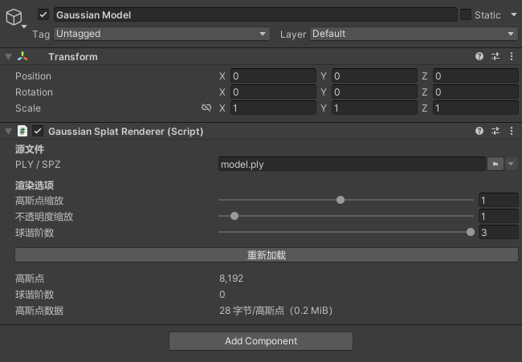
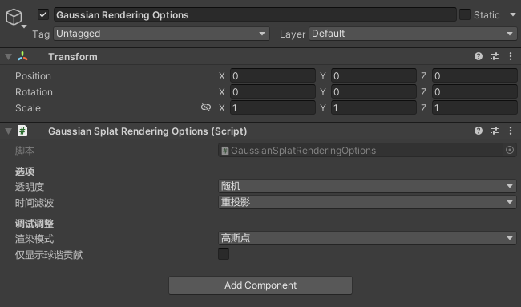

# Unity Gaussian Splatting 中文版

在 Unity 中加载和显示 3D Gaussian Splatting（3DGS）模型，基于 [aras-p/UnityGaussianSplatting](https://github.com/aras-p/UnityGaussianSplatting) 2.0.0。


## 功能

- 直接加载高斯模型 `.ply` 和 `.spz`，支持 SPZ 1～4、0～3 阶球谐数据，无需转换资产。
- 支持内置渲染管线、URP 和 HDRP，可在编辑模式下预览。
- 支持多个高斯对象全局排序，也可使用随机透明渲染，搭配多帧累积或重投影滤波。
- 可调整模型位置、旋转、缩放、高斯点大小、不透明度和球谐阶数，支持配套相机视角和点模式调试。
- 支持拖入文件、浏览本地文件、选择最近使用的路径，以及从网址加载模型。
- 界面跟随 Unity 编辑器语言：中文使用中文，其他语言使用英文。

## 安装

内置渲染管线需要 **Unity 2022.3 或更新版本**；URP、HDRP 需要 **Unity 6 或更新版本**。

1. 打开 Unity 的包管理器：`Window > Package Manager`。
2. 点击左上角 `+`，选择 `Add package from git URL...`（从 Git 网址添加包）。
3. 输入下面的地址，点击添加，等待安装与编译完成：

   ```text
   https://github.com/Funny-Rainbow/UnityGaussianSplatting-ZH.git?path=/package#ZH
   ```

从 Git 安装需要电脑已安装 Git。也可以下载仓库，在包管理器中选择 `Add package from disk...`（从磁盘添加包），打开 `package/package.json`。

## 配置渲染管线

**Windows 请先切换到 Direct3D 12 或 Vulkan。** 打开 `Edit > Project Settings > Player > Other Settings`，关闭 Windows 的 `Auto Graphics API`，将 Direct3D12 或 Vulkan 放到首位，按提示重启编辑器。macOS 使用 Metal，Linux 使用 Vulkan。需要支持计算着色器的显卡；不支持 Direct3D 11、OpenGL 和 MSAA。

### 内置渲染管线

无需额外设置，直接按下一节添加模型。

### URP

1. 找到相机使用的 **Renderer Data** 资源，在 Inspector 中点击 `Add Renderer Feature`，添加 `GaussianSplatURPFeature`。
2. 在 URP 设置中关闭 Render Graph 的 `Compatibility Mode`。
3. 关闭 MSAA。使用 OpenXR 时，将立体渲染模式设为 `Multi-Pass`。

### HDRP

1. 在场景中添加 **Custom Pass Volume**，勾选 `Is Global`。
2. 在自定义通道列表中添加 `GaussianSplatHDRPPass`。
3. 注入点选择 `Before Transparent` 或 `After Post Process`。如果自动曝光造成亮度异常，可改用 `After Post Process`。
4. 确认相机允许 Custom Pass，并关闭 MSAA。

## 加载模型

准备一个训练好的高斯模型：二进制 `.ply` 或 `.spz`。PLY 需要包含 3DGS 属性，格式为 `binary_little_endian 1.0`，高斯属性使用 `float`；普通点云或 ASCII PLY 不能直接使用。

1. 在项目的 `Assets` 下创建 `StreamingAssets` 文件夹，将模型放入其中，例如 `Assets/StreamingAssets/model.ply`。
2. 在场景中创建一个空对象，点击 `Add Component`，添加 `GaussianSplatRenderer`。
3. 将模型拖到组件的 **PLY / SPZ** 字段，或点击文件夹按钮选择文件。也可以直接填写 `model.ply`。
4. 等待加载完成。组件下方出现高斯点数量和球谐阶数，就表示文件已加载；如果失败，组件会显示错误信息。
5. 选中模型对象，在 Scene 视图按 **F** 聚焦。用 Transform 调整模型位置、旋转和整体缩放；需要在 Game 视图显示时，将主相机移到能看到模型的位置。



| 中文界面 | 英文界面 | 用途 |
| --- | --- | --- |
| 高斯点缩放 | Splat Scale | 调整单个高斯点的大小。整个模型的尺寸用 Transform 缩放。 |
| 不透明度缩放 | Opacity Scale | 调整模型的不透明度。 |
| 球谐阶数 | SH Order | 设置显示使用的球谐阶数，范围为 0～3，受源文件数据限制。 |
| 重新加载 | Reload | 源文件修改后，点击重新读取。 |

放置多个模型时，为每个对象分别添加组件并指定文件。

如果有配套的 3DGS 相机 JSON，将它与模型放在一起并使用同名文件，例如 `model.ply` 与 `model.json`。加载后通过组件中的“相机”（Camera）滑块切换视角；场景中需有带 `MainCamera` 标签的相机。

## 调整渲染效果

在场景中的一个对象上添加 **GaussianSplatRenderingOptions**，设置会应用到所有高斯对象。不添加时使用默认设置。

- **透明度（Transparency）**：默认“排序混合”（Sorted Blended），对高斯点排序后混合。“随机”（Stochastic）无需排序，但单帧会有噪点。
- **时间滤波（Temporal Filter）**：选择随机透明渲染后出现。“简单累积”（Simple Accumulation）适合静止视角；“重投影”（Reprojected）支持视角移动；“无”（None）关闭滤波。
- **渲染模式（Render Mode）**：“高斯点”（Splats）为正常显示；“调试点”（Debug Points）用于查看点的分布，可通过“点显示大小”（Point Display Size）调整大小。
- **仅显示球谐贡献（SH Only）**：使用灰色基底查看球谐数据带来的视角变化。

下图选择了“随机”透明渲染和“重投影”时间滤波：



高斯模型使用自身的颜色和球谐数据，不受 Unity 灯光、阴影或光照贴图影响。普通不透明物体可以遮挡高斯模型；与普通半透明物体混合仍有限制。

## 文件路径与打包

**PLY / SPZ** 字段也可以填写绝对路径或模型下载地址：

```text
model.ply
models/garden.spz
D:/Models/garden.ply
https://example.com/models/garden.spz
```

相对路径优先从 `StreamingAssets` 查找，找不到时再从当前工作目录查找。网址需要能直接下载模型，路径保留 `.ply` 或 `.spz` 后缀。

随应用发布的模型放在 `Assets/StreamingAssets`，组件填写相对路径。其他目录中的文件不会自动进入构建，需要自行部署，或通过网址加载。

## 打开示例项目

下载或克隆仓库的 `ZH` 分支：

```bash
git clone --branch ZH https://github.com/Funny-Rainbow/UnityGaussianSplatting-ZH.git
```

在 Unity Hub 中添加对应目录，然后打开 `Assets/GSTestScene.unity`，将场景中的模型路径换成自己的文件：

| 渲染管线 | 项目目录 | Unity 版本 |
| --- | --- | --- |
| 内置渲染管线 | `projects/GaussianExample` | 2022.3 |
| URP | `projects/GaussianExample-URP` | 6 |
| HDRP | `projects/GaussianExample-HDRP` | 6 |

保留仓库目录结构，示例项目通过相对路径引用根目录的 `package`。

原作者：[Aras Pranckevičius](https://github.com/aras-p) · 中文版：[Funny-Rainbow](https://github.com/Funny-Rainbow) · [MIT 许可证](LICENSE.md)
